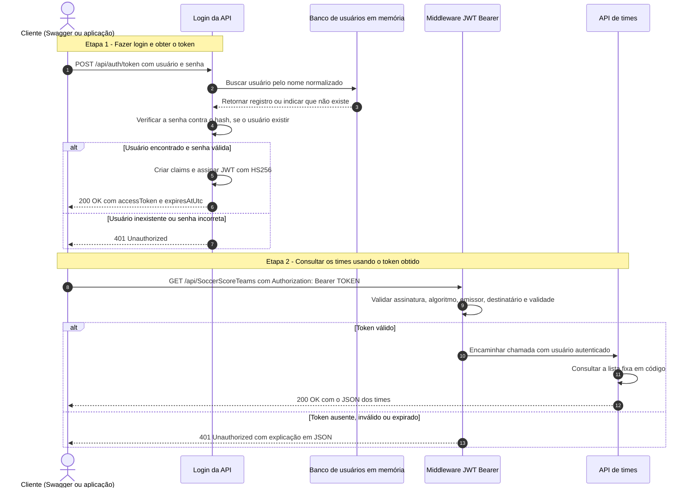

# SampleJwtAuth

API de exemplo em **.NET 10** para cadastrar usuários, fazer login e consultar uma lista fixa de times brasileiros. Esta documentação foi escrita para alunos de **Sistemas de Informação (SI)** que estão aprendendo a desenvolver APIs e trabalhar com autenticação. Os nomes de classes, métodos e propriedades permanecem em inglês; os comentários explicativos estão em português brasileiro.

## O que você vai aprender

Ao executar este projeto, você poderá cadastrar um usuário, usar esse cadastro para obter um token e enviar o token para acessar uma informação protegida. Também poderá acompanhar no código onde cada uma dessas etapas acontece.

Antes de começar, conheça os termos que aparecem neste material:

| Termo | Significado neste projeto |
| --- | --- |
| API | Aplicação que recebe pedidos HTTP e devolve respostas para outros programas |
| Endpoint ou rota | Endereço de uma operação da API, como `/api/auth/token` |
| Requisição | Pedido enviado pelo cliente, como o navegador, o Swagger ou outro sistema |
| Cliente | Programa que faz a chamada para a API |
| JSON | Formato de texto utilizado para enviar e receber os dados |
| Autenticação | Verificação de quem está acessando o sistema |
| Autorização | Verificação de quais recursos uma pessoa autenticada pode acessar |
| Token | Texto usado como comprovante de autenticação nas próximas chamadas |
| JWT | Formato do token usado aqui, que reúne informações e uma assinatura digital verificável |
| Bearer | Esquema em que quem apresenta um token válido pode usá-lo para acessar o recurso protegido |
| Hash de senha | Resultado de uma função própria para proteger senhas; a API verifica a senha sem guardar seu texto original |
| Middleware | Componente que processa a requisição antes de ela chegar ao método do endpoint |
| Claim | Informação contida no token, como o usuário ou a data de expiração |

Pense no fluxo como uma entrada em um evento: o cadastro registra seus dados, o login confere sua identidade e o token funciona como uma credencial temporária. Nas próximas chamadas, você apresenta essa credencial. A API verifica se ela é válida antes de liberar o acesso. Como qualquer pessoa que possua o token pode apresentá-lo, mantenha-o privado.

## Roteiro sugerido para a aula

1. Execute o projeto e abra o Swagger, seguindo as instruções abaixo.
2. Tente consultar os times sem token e observe a resposta `401`.
3. Cadastre um usuário e observe a resposta `201`.
4. Faça login com esse usuário e copie o token retornado.
5. Autorize a chamada no Swagger e consulte os times novamente; agora a resposta deve ser `200`.
6. Faça login com uma senha incorreta e compare o resultado com o login válido.
7. Leia a seção de configuração JWT para entender o que a API conferiu para permitir o acesso.

Os números `200`, `201` e `401` são códigos de status HTTP: respectivamente, indicam sucesso, criação de um recurso e ausência de autenticação válida. Eles aparecem nas respostas do Swagger.

## Tecnologias e organização

- ASP.NET Core 10 para os endpoints HTTP.
- Entity Framework Core InMemory para armazenar usuários durante a execução.
- ASP.NET Core Identity `PasswordHasher<User>` para gerar e verificar hashes de senha.
- JWT Bearer para autenticação das chamadas protegidas.
- Swashbuckle para documentação OpenAPI e testes pelo Swagger UI.

A arquitetura limpa está organizada por pastas dentro de um único projeto:

```text
src/
├── Domain/                              # Entidades do domínio
│   ├── User.cs                          # Usuário e hash da senha
│   └── SoccerTeam.cs                    # Dados de um time
├── Application/                         # Casos de uso e contratos
│   ├── Authentication/
│   │   ├── IAuthenticationService.cs    # Contrato do login
│   │   ├── IPasswordService.cs          # Contrato de proteção de senhas
│   │   ├── IUserRepository.cs           # Contrato de acesso aos usuários
│   │   ├── RegisterUser.cs              # Caso de uso de cadastro
│   │   └── TokenResponse.cs             # Dados retornados pelo login
│   └── Teams/
│       ├── GetSoccerScoreTeams.cs       # Caso de uso de consulta
│       └── ISoccerTeamRepository.cs     # Contrato de acesso aos times
├── Infrastructure/                      # Implementações dos contratos
│   ├── Authentication/
│   │   ├── JwtAuthenticationService.cs  # Verifica credenciais e emite JWT
│   │   ├── JwtOptions.cs                # Opções e regras de configuração
│   │   └── PasswordService.cs           # Gera e verifica hashes de senha
│   ├── Persistence/
│   │   ├── AuthDbContext.cs             # Contexto do banco em memória
│   │   └── InMemoryUserRepository.cs    # Salva e consulta usuários
│   └── Teams/
│       └── InMemorySoccerTeamRepository.cs # Lista fixa de times
├── Presentation/                        # Entrada e saída HTTP
│   ├── Controllers/
│   │   ├── AuthController.cs            # Cadastro e login
│   │   └── SoccerScoreTeamsController.cs # Consulta protegida por JWT
│   └── Swagger/
│       └── BearerSecurityOperationFilter.cs # Documenta a autenticação
├── Properties/
│   └── launchSettings.json              # Perfil local de execução
├── appsettings.json                     # Configurações gerais
├── appsettings.Development.json         # Configuração local (chave não publicada)
├── Program.cs                           # Serviços e pipeline HTTP
├── SampleJwtAuth.csproj                  # Projeto e dependências
└── SampleJwtAuth.http                    # Exemplos de requisições
```

As pastas representam as responsabilidades de cada parte do sistema:

- `Domain` (domínio): representa os dados principais, como usuário e time, sem depender das outras camadas.
- `Application` (aplicação): descreve as operações do sistema e define interfaces, que são contratos sobre o que um serviço deve fazer.
- `Infrastructure` (infraestrutura): implementa esses contratos, incluindo o acesso ao banco, a proteção das senhas e a geração do token.
- `Presentation` (apresentação): recebe os pedidos HTTP por meio dos controllers e devolve as respostas ao cliente.

O arquivo `.csproj` define o projeto .NET. Neste exemplo existe apenas um projeto, portanto as camadas estão separadas por pastas. Essa organização ajuda a estudar a arquitetura, mas o compilador não impede uma referência indevida entre as camadas como poderia acontecer com projetos separados.

## Diagrama do fluxo de autenticação e consulta

O diagrama mostra duas etapas: obter o token pelo login e apresentar esse token ao consultar os times. Antes do login, o usuário precisa estar cadastrado pelo endpoint `POST /api/auth/register`.



A segunda etapa só pode ter sucesso com um token válido. A API consulta o banco de usuários durante o login; na chamada protegida, valida o JWT sem consultar esse banco novamente. O middleware rejeita um token inválido antes que a consulta dos times seja executada.

No Swagger, cole somente o valor de `accessToken` em **Authorize**. O cabeçalho enviado terá exatamente um prefixo: `Authorization: Bearer TOKEN`.

O diagrama usa Mermaid e pode ser visualizado na página do README no GitHub ou em uma prévia Markdown com suporte a Mermaid.
## Como executar

Pré-requisito: SDK do .NET 10 instalado. O SDK é o conjunto de ferramentas necessário para compilar e executar o código. Você pode conferir sua instalação executando `dotnet --version` no terminal.

Na raiz do repositório, execute:

```powershell
dotnet build SampleJwtAuth.slnx
# Generate a local signing key before starting the API.
$env:Jwt__SigningKey = [guid]::NewGuid().ToString('N') + [guid]::NewGuid().ToString('N')
dotnet run --project src/SampleJwtAuth.csproj
```

O perfil local usa o ambiente `Development` e a URL `http://localhost:5080`.

`localhost` representa o seu próprio computador, e `5080` é a porta em que a API atende. Mantenha o terminal em execução enquanto faz os testes. O Swagger é uma página que permite enviar requisições sem precisar criar uma aplicação cliente.

- Swagger UI: `http://localhost:5080/swagger`
- Documento OpenAPI: `http://localhost:5080/swagger/v1/swagger.json`

O Swagger está habilitado somente em `Development`. O banco começa vazio: cadastre um usuário antes de fazer login. Os dados são perdidos quando o processo da API é encerrado.

## Endpoints

| Método | Rota | Autenticação | Finalidade |
| --- | --- | --- | --- |
| POST | `/api/auth/register` | Pública | Cadastrar usuário no banco em memória |
| POST | `/api/auth/token` | Pública | Validar credenciais e obter um JWT |
| GET | `/api/SoccerScoreTeams` | JWT Bearer | Consultar a lista fixa de times |

### 1. Cadastrar um usuário

Envie para `POST /api/auth/register`:

```json
{
  "username": "user",
  "password": "pass@123"
}
```

O nome de usuário deve ter entre 3 e 100 caracteres; a senha, entre 8 e 256. Os campos são obrigatórios. As regras atuais validam tamanho, sem exigir combinações específicas de símbolos, letras ou números.

O caso de uso `RegisterUser` remove espaços nas extremidades do nome, cria uma versão normalizada em maiúsculas e gera um hash da senha com `PasswordHasher<User>`. O repositório salva o usuário no `AuthDbContext`, usando o banco nomeado `SampleJwtAuth`.

A comparação dos nomes ignora maiúsculas, minúsculas e espaços nas extremidades: `user` e ` USER ` identificam a mesma conta. A senha é verificada como recebida, sem essa normalização.

Resposta `201 Created`:

```json
{
  "username": "user"
}
```

A resposta não expõe a senha nem seu hash. Um nome já cadastrado retorna `409 Conflict`; campos inválidos retornam `400 Bad Request`.

### 2. Fazer login e recuperar o token

Envie as credenciais cadastradas para `POST /api/auth/token`:

```json
{
  "username": "user",
  "password": "pass@123"
}
```

`AuthController` chama `JwtAuthenticationService.Authenticate`. Esse serviço consulta `IUserRepository.FindByUsername`, cuja implementação busca o registro no banco em memória. `PasswordService` verifica a senha recebida contra o hash armazenado.

Com as credenciais válidas, a API retorna `200 OK`. Exemplo ilustrativo do formato:

```json
{
  "accessToken": "<JWT gerado pela API>",
  "tokenType": "Bearer",
  "expiresAtUtc": "2026-10-22T15:30:00Z"
}
```

- `accessToken`: token que deve acompanhar as chamadas protegidas.
- `tokenType`: esquema de autenticação utilizado, `Bearer`.
- `expiresAtUtc`: instante de expiração em UTC, calculado a partir da emissão.

A resposta do login inclui `Cache-Control: no-store`. Usuário inexistente ou senha incorreta retorna `401 Unauthorized`; campos inválidos retornam `400 Bad Request`.

O endpoint gera um novo token a cada login bem-sucedido. Não existe endpoint para recuperar um token antigo, renovar por refresh token ou efetuar logout no servidor. Quando o token expirar, faça login novamente.

### 3. Consultar os times com o token

Envie o token no cabeçalho HTTP, com exatamente um prefixo `Bearer`:

```http
GET /api/SoccerScoreTeams HTTP/1.1
Host: localhost:5080
Accept: application/json
Authorization: Bearer <accessToken>
```

Exemplo com curl:

```bash
curl 'http://localhost:5080/api/SoccerScoreTeams' \
  -H 'accept: application/json' \
  -H 'Authorization: Bearer SEU_ACCESS_TOKEN'
```

Com o token válido, a API retorna `200 OK` com um array JSON. O primeiro item é:

```json
[
  {
    "id": 1,
    "name": "Cruzeiro",
    "abbreviation": "CRU",
    "city": "Belo Horizonte",
    "state": "MG"
  }
]
```

O exemplo acima mostra apenas o primeiro item. A resposta completa contém, nesta ordem: Cruzeiro, São Paulo (SPFC), Palmeiras, Flamengo, Corinthians, Santos, Atlético Mineiro, Grêmio, Internacional, Botafogo, Fluminense e Vasco da Gama.

Os times vêm de uma lista fixa em `InMemorySoccerTeamRepository`, sem consulta externa ou tabela no banco. O EF Core InMemory é utilizado para os usuários.

## Testar o fluxo pelo Swagger

1. Acesse `http://localhost:5080/swagger`.
2. Expanda `POST /api/auth/register`, clique em **Try it out**, informe os dados e clique em **Execute**.
3. Execute `POST /api/auth/token` com o mesmo usuário e senha.
4. Copie apenas o valor de `accessToken`, sem aspas.
5. Clique em **Authorize**, cole apenas o token e confirme; o Swagger acrescenta `Bearer` automaticamente.
6. Execute `GET /api/SoccerScoreTeams` para consultar os times.

Se o curl gerado mostrar `Authorization: Bearer Bearer eyJ...`, o prefixo foi informado duas vezes. Em **Authorize**, clique em **Logout** e autorize novamente colando somente o token que começa com `eyJ`.

## Exemplo completo em PowerShell

Com a API em execução e um banco recém-iniciado:

```powershell
$baseUrl = 'http://localhost:5080'
$body = @{
    username = 'user'
    password = 'pass@123'
} | ConvertTo-Json

# Register the account before logging in.
Invoke-RestMethod -Method Post -Uri "$baseUrl/api/auth/register" `
    -ContentType 'application/json' -Body $body

# Obtain a signed access token using the stored credentials.
$login = Invoke-RestMethod -Method Post -Uri "$baseUrl/api/auth/token" `
    -ContentType 'application/json' -Body $body

# Send the token to the protected endpoint.
$teams = Invoke-RestMethod -Uri "$baseUrl/api/SoccerScoreTeams" `
    -Headers @{ Authorization = "Bearer $($login.accessToken)" }

$teams | ConvertTo-Json
```

Se o usuário já existir, pule o cadastro e faça login. Também há exemplos de requisições em `src/SampleJwtAuth.http`.

## Como o JWT está configurado neste projeto

### Valores de configuração

Em `src/appsettings.json`:

```json
{
  "Jwt": {
    "Issuer": "SampleJwtAuth",
    "Audience": "SoccerScoreTeams",
    "ExpirationMinutes": 30
  }
}
```

Em `src/appsettings.Development.json`, `SigningKey` fica vazia intencionalmente. Antes de iniciar a API, gere a variável de ambiente `Jwt__SigningKey` conforme o exemplo de execução. Nenhuma chave de assinatura é publicada no repositório.

| Configuração | Valor ou regra atual | Uso |
| --- | --- | --- |
| `Issuer` | `SampleJwtAuth` | Identifica quem emitiu o token |
| `Audience` | `SoccerScoreTeams` | Identifica o destinatário esperado |
| `ExpirationMinutes` | `30` | Define o prazo de validade desde a emissão |
| `SigningKey` | Fornecida localmente por variável de ambiente | Assina e valida o token |
| Algoritmo | HS256 (`HmacSha256`) | Assinatura simétrica com HMAC-SHA256 |
| `ClockSkew` | `TimeSpan.Zero` | Não acrescenta tolerância de tempo à validade |
| `MapInboundClaims` | `false` | Preserva os nomes originais das claims |

`JwtOptions` exige emissor, destinatário e chave preenchidos, chave com pelo menos 32 caracteres e validade entre 1 e 60 minutos. `ValidateDataAnnotations().ValidateOnStart()` verifica essas regras na inicialização.

A chave é convertida em bytes UTF-8 e usada como `SymmetricSecurityKey`. Por ser uma assinatura simétrica, a mesma chave é usada para emitir e validar os JWTs. Essa chave pertence ao servidor e não deve ser enviada ao cliente.

### Conteúdo do token

O JWT contém informações chamadas **claims**. Elas ajudam o servidor a identificar a quem o token pertence, quem o emitiu e por quanto tempo ele pode ser aceito. Não é necessário montar esse texto manualmente: a biblioteca utilizada pela API faz isso.

`JwtAuthenticationService` utiliza `TimeProvider` para obter a hora UTC e cria as seguintes claims:

| Claim | Conteúdo |
| --- | --- |
| `sub` | Nome do usuário autenticado |
| `jti` | GUID único gerado para aquele token |
| `iat` | Instante de emissão em segundos Unix |
| `nbf` | Instante a partir do qual o token pode ser aceito |
| `exp` | Instante de expiração |
| `iss` | Emissor configurado |
| `aud` | Destinatário configurado |

O token tem três partes: `header.payload.signature`. Ele é assinado, sem criptografia do conteúdo: as claims podem ser lidas por quem possui o token. A senha e seu hash não são incluídos nele.

Em português, essas partes são: **cabeçalho**, que informa o tipo e o algoritmo; **conteúdo**, que reúne as claims; e **assinatura**, que permite verificar a integridade e a origem do token usando a chave configurada. Alterar uma informação do conteúdo sem gerar uma assinatura válida faz a validação falhar. Apenas conseguir ler o conteúdo não significa que o token seja confiável.

### Validação nas chamadas protegidas

Em `Program.cs`, `AddAuthentication(JwtBearerDefaults.AuthenticationScheme).AddJwtBearer()` registra o esquema Bearer. A validação exige:

- Assinatura válida com a chave configurada (`ValidateIssuerSigningKey`).
- Emissor correspondente a `Jwt:Issuer` (`ValidateIssuer`).
- Destinatário correspondente a `Jwt:Audience` (`ValidateAudience`).
- Token dentro do período de validade (`ValidateLifetime`).
- Algoritmo HMAC-SHA256, definido em `ValidAlgorithms`.

`UseAuthentication()` executa antes de `UseAuthorization()`: primeiro identifica o usuário a partir do token; depois verifica a exigência de autenticação do endpoint. O controller `SoccerScoreTeamsController` possui `[Authorize]`; cadastro e login usam `[AllowAnonymous]`.

Uma chamada com JWT válido não consulta novamente o cadastro no banco. A validação usa o próprio token e a configuração do servidor. O projeto não implementa revogação ou lista de bloqueio; por isso, um token já emitido pode continuar válido até expirar, inclusive após reiniciar a API, se a chave e as demais configurações permanecerem iguais. O cadastro em memória, entretanto, será perdido e precisará ser recriado para um novo login.

### Fluxo resumido: uma linha por etapa

1. O cliente envia usuário e senha para `POST /api/auth/token`.
2. A API busca o usuário cadastrado no banco em memória.
3. A senha recebida é verificada contra o hash armazenado.
4. Com as credenciais válidas, a API cria as claims e define a validade de 30 minutos.
5. A API assina o JWT com a chave configurada e retorna o `accessToken` em JSON.
6. O cliente envia `Authorization: Bearer <accessToken>` na consulta dos times.
7. O middleware valida assinatura, emissor, destinatário, algoritmo e validade do JWT.
8. Com o token válido, a consulta retorna os times; caso contrário, retorna `401 Unauthorized`.

## Respostas de erro e diagnóstico

| Situação | Resposta |
| --- | --- |
| Campos obrigatórios ausentes ou fora dos limites | `400 Bad Request` |
| Nome de usuário já cadastrado | `409 Conflict` |
| Usuário inexistente ou senha incorreta no login | `401 Unauthorized` |
| Token ausente, adulterado, expirado ou com configuração incompatível | `401 Unauthorized` |
| Cabeçalho com `Bearer Bearer` | `401 Unauthorized`, com explicação do prefixo duplicado |

Nas chamadas protegidas, o evento `OnChallenge` retorna um JSON no formato Problem Details e o cabeçalho `WWW-Authenticate: Bearer`. O login inválido retorna `Unauthorized()` pelo controller e não usa esse evento para personalizar a mensagem.

Ao receber `401`, confirme o prefixo único, gere um novo token caso tenha expirado e verifique se a API está usando a mesma chave, emissor e destinatário da emissão. Se o login falhar após reiniciar a aplicação, cadastre o usuário novamente.

## Configuração fora do ambiente local

Fora de `Development`, forneça `Jwt__SigningKey` por variável de ambiente ou um serviço de segredos. As configurações também podem ser sobrescritas por `Jwt__Issuer`, `Jwt__Audience` e `Jwt__ExpirationMinutes`.

Use uma chave exclusiva e gerenciada como segredo em uma implantação real. O pipeline habilita redirecionamento HTTPS fora de `Development`; a hospedagem precisa ter HTTPS configurado.

Este projeto é didático: o banco InMemory não oferece persistência e não é armazenamento de produção. Para evoluí-lo, considere um banco persistente e um provedor de identidade apropriado. Atualmente não existem refresh tokens, recuperação de senha, revogação, perfis de acesso ou políticas baseadas em roles.

## Arquivos principais para acompanhar o fluxo

| Arquivo | Responsabilidade |
| --- | --- |
| [AuthController.cs](src/Presentation/Controllers/AuthController.cs) | Receber cadastro e login e retornar as respostas HTTP |
| [RegisterUser.cs](src/Application/Authentication/RegisterUser.cs) | Preparar o cadastro e gerar o hash da senha |
| [InMemoryUserRepository.cs](src/Infrastructure/Persistence/InMemoryUserRepository.cs) | Salvar e consultar usuários no banco em memória |
| [AuthDbContext.cs](src/Infrastructure/Persistence/AuthDbContext.cs) | Configurar a entidade de usuário no EF Core |
| [PasswordService.cs](src/Infrastructure/Authentication/PasswordService.cs) | Gerar e verificar hashes com o PasswordHasher |
| [JwtAuthenticationService.cs](src/Infrastructure/Authentication/JwtAuthenticationService.cs) | Validar credenciais e emitir o JWT |
| [JwtOptions.cs](src/Infrastructure/Authentication/JwtOptions.cs) | Definir e validar as opções JWT |
| [Program.cs](src/Program.cs) | Configurar dependências, Swagger e validação Bearer |
| [SoccerScoreTeamsController.cs](src/Presentation/Controllers/SoccerScoreTeamsController.cs) | Expor a consulta protegida de times |

## Pratique no seu computador

Consulte o [roteiro de desafios para alunos](DESAFIOS.md), com instruções para baixar o projeto e trabalhar no seu próprio computador. As propostas incluem criar uma rota de consulta por identificador, integrar com SQLite, cadastrar times no banco e testar a autenticação.

Os desafios são exercícios para você implementar; não fazem parte das funcionalidades atuais da API. Você pode estudar no seu fork e, se desejar, enviar sua solução por pull request.

## Licença

Este projeto utiliza a [licença MIT](LICENSE), que permite usar, estudar, copiar, modificar e distribuir o código, preservando o aviso de direitos autorais e a licença. Ela também permite uso comercial; não é uma licença restrita ao ambiente acadêmico. O projeto é disponibilizado sem garantia.

## Contribuições

Este é um projeto colaborativo. Fique à vontade para fazer um fork, implementar melhorias e abrir um pull request (PR) para contribuir com o projeto.

Melhorias, críticas e sugestões são sempre bem-vindas!

A chave local gerada vale para o processo iniciado nesse terminal. Ao trocar a chave, os tokens anteriores deixam de ser aceitos. Sem `Jwt__SigningKey`, a validação de configuração impede a API de iniciar.
